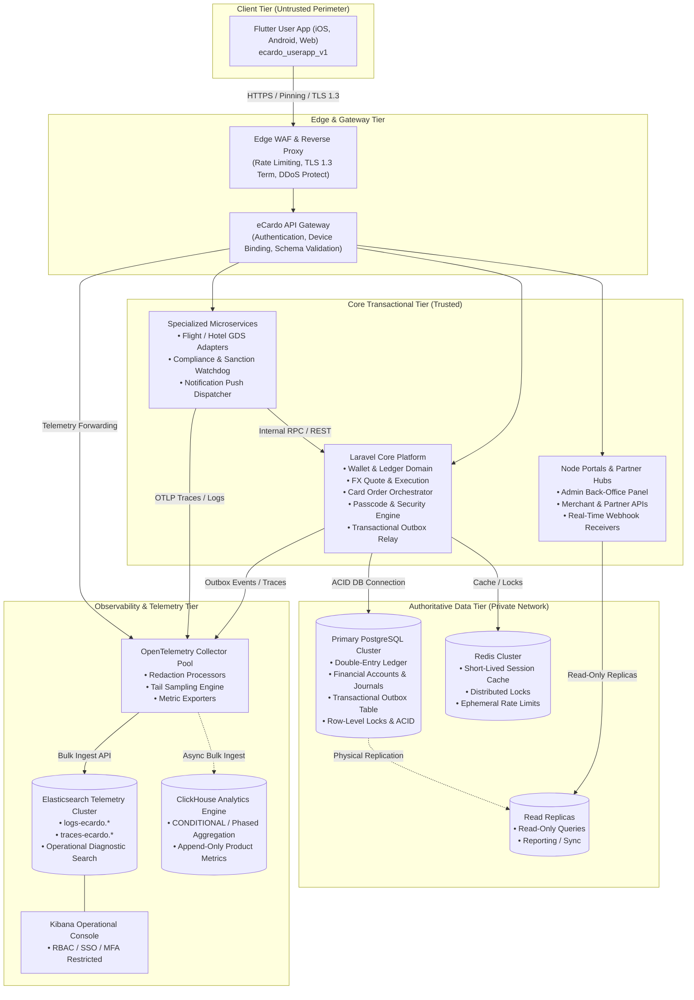
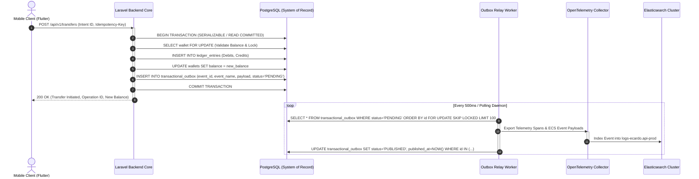

# eCardo Target Platform Architecture

- **Document Version:** 1.0.0
- **Status:** APPROVED / TARGET ARCHITECTURE
- **Date:** 2026-10-18
- **Domain:** Fintech, Cross-Border Payments, Multi-Currency Digital Wallets, Travel & Commerce
- **Target Repository:** `ecardo_userapp_v1`
- **Applicable Services:** Flutter Mobile & Web Client, Laravel Core Backend, Node Admin/Partner Portals, Specialized Microservices, OpenTelemetry Collector, Elasticsearch Cluster, PostgreSQL Relational Store

---

## 1. Executive Summary & Core Philosophy

The eCardo platform is an international multi-service financial super-app combining multi-currency digital wallets, P2P and cross-border currency exchange, virtual and physical payment card issuance, bill payments, and integrated international travel/commerce bookings (flights, hotels, transport, and tours).

Fintech platforms operate in high-consequence environments where eventual consistency, race conditions, or uncoordinated background jobs can result in catastrophic double-spending, ledger divergence, or regulatory sanctions. The eCardo Target Architecture is engineered on six foundational principles:

1. **Relational Ledger as Sole Source of Truth:** Money movements, account balances, holds, and settlements are strictly recorded in an ACID-compliant relational double-entry ledger. Elasticsearch, ClickHouse, Redis, and client caches are downstream read models and are **never** authoritative for financial state.
2. **Thin Client, Server Authoritative:** The Flutter client manages user interactions, optimistic UI transitions, and form validation, but every financial mutation, tier limit, fee calculation, and provider dispatch is authoritatively decided and enforced on the backend.
3. **Transactional Outbox for Guaranteed Consistency:** Financial mutations and their corresponding event notifications are committed in a single atomic database transaction. Dedicated outbox workers relay events asynchronously with at-least-once delivery, while consumers ensure idempotency via unique event IDs.
4. **Provider Capability Registry & Fail-Closed Adapters:** All external payment gateways, FX quote engines, card issuers, and KYC vendors are encapsulated behind strict provider adapters governed by a dynamic capability registry. If a provider is disabled or unsupported, the backend rejects the operation fail-closed.
5. **Observability by Design with Strict Data Minimization:** Every request carries distributed correlation IDs (`trace.id`, `correlation_id`, `operation_id`) from client through backend to third-party callbacks. PII and financial credentials (PAN, CVV, PIN, passwords, tokens) are aggressively redacted before exiting runtime processes.
6. **Progressive Architectural Scaling:** System complexity is added strictly when justified by measured operational metrics. Standard background queues and relational outboxes handle initial baseline workloads; distributed streaming (Kafka/Redpanda) and analytical columnar engines (ClickHouse) are activated conditionally based on clear volume thresholds.

---

## 2. System Context & Bounded Domains

The eCardo system topology is segregated into five distinct runtime tiers with strict network and architectural trust boundaries:



### 2.1 Bounded Domain Definitions & Responsibilities

| Domain / Subsystem | Primary Technology | Core Responsibilities | State Ownership | Invariants & Constraints |
| :--- | :--- | :--- | :--- | :--- |
| **Mobile & Web Client** | Flutter 3.x / Dart 3.x (`ecardo_userapp_v1`) | User intent capture, screen rendering, biometrics/passcode challenge UI, local caching, client-side telemetry spooling. | Ephemeral local state, secure hardware keystore tokens. | **Never computes balances.** Never makes direct connections to database or Elasticsearch clusters. |
| **API Gateway & Ingress** | Nginx / OpenResty / Cloudflare WAF | TLS termination, IP rate limiting, token validation, W3C trace-context injection, correlation ID propagation. | Stateless. | Rejects malformed JSON and unauthorized headers at the network perimeter. |
| **Laravel Core Platform** | PHP 8.x / Laravel Framework | Financial business logic, double-entry ledger bookkeeping, wallet operations, FX quotation, card issuing orchestration, outbox event generation. | Authoritative owner of PostgreSQL transactional state. | All balance mutations must occur within serialized or read-committed database transactions. |
| **Node Admin & Partner Portals** | Node.js / TypeScript (Express / Fastify) | Administrative back-office management, compliance officer portal, customer support lookup, partner webhook reception. | Read-model projections, audit logs. | Read queries routed to PostgreSQL read-replicas; administrative mutations routed through Laravel Core APIs. |
| **Specialized Microservices** | Go / Python / Node.js | Travel GDS aggregators (flights, hotels), asynchronous document generation (PDF travel vouchers), heavy notification fan-out. | Service-specific cache, transient job state. | Inter-service calls authenticated with mTLS; failures isolated via circuit breakers. |
| **Relational Database** | PostgreSQL 16+ (Active-Passive HA) | System of Record: Financial accounts, double-entry journals, transaction states, provider configurations, transactional outbox table. | Sole source of truth for financial & business entities. | Enforces relational foreign keys, row-level concurrency locking (`FOR UPDATE`), WAL archiving. |
| **Telemetry & Observability** | OpenTelemetry, Elasticsearch, ClickHouse | Log indexing, APM trace correlation, health monitoring, SLO tracking, aggregated analytical metrics. | Read-only operational indices & time-series streams. | **Zero financial authority.** Completely decoupled from transactional commit paths. |

---

## 3. Single Source of Truth Invariants & Transactional Consistency

### 3.1 The Absolute Ledger Invariant
Under no circumstances may any component of the eCardo ecosystem treat Elasticsearch, ClickHouse, Redis, or local client storage as authoritative for monetary figures, account balances, or transaction completion states.

```
+---------------------------------------------------------------------------------------------------+
|                                  THE FINANCIAL LEDGER INVARIANT                                   |
+---------------------------------------------------------------------------------------------------+
| 1. PostgreSQL is the SOLE SYSTEM OF RECORD for ledger journals, wallet balances, and finality.   |
| 2. Balances are derived exclusively from immutable, double-entry credit and debit postings.      |
| 3. Account balance caches in Redis or client memory are ephemeral projections:                   |
|    - Caches must have short TTLs (<= 60 seconds).                                                |
|    - Caches are NEVER used to authorize debits or transfers without a database lock validation.  |
| 4. Elasticsearch search indexes are asynchronous diagnostic projections:                          |
|    - An index lag of minutes or hours has ZERO effect on actual user wallet funds.               |
|    - Financial queries for user balances NEVER query Elasticsearch.                              |
+---------------------------------------------------------------------------------------------------+
```

### 3.2 Double-Entry Bookkeeping & Concurrency Control
All financial accounts adhere to standard double-entry bookkeeping rules:
- **Total Balance Conservation:** Every monetary operation creates at least one debit posting and one credit posting. The sum of debits must equal the sum of credits ($$\sum \text{Debits} = \sum \text{Credits}$$).
- **Immutable Journal Entries:** Ledger entries cannot be modified or deleted. Adjustments and refunds are achieved exclusively by posting compensating journal entries (`reversal_committed`).
- **Pessimistic Concurrency Locking:** Concurrent debits on a single wallet execute `SELECT balance, status FROM wallets WHERE id = :id FOR UPDATE`, preventing race conditions and double-spending across parallel mobile requests.

### 3.3 Transactional Outbox Pattern

To eliminate dual-write hazards between the relational database and downstream message queues or search indices, eCardo utilizes the **Transactional Outbox Pattern**:



#### Outbox Invariants:
1. **Atomic Coupling:** The financial ledger mutation and the outbox event row are committed in the exact same relational database transaction. A failure in either rolls back both.
2. **At-Least-Once Delivery:** Outbox workers poll using `SELECT ... FOR UPDATE SKIP LOCKED` or listen to PostgreSQL WAL logical decoding (CDC). Events are guaranteed to be published at least once.
3. **Consumer Idempotency:** Every event envelope carries a globally unique `event.id` (UUIDv4/ULID) and an `operation_id`. All downstream event consumers (push notifications, indexing pipelines, analytics) maintain a deduplication table with a minimum retention equal to the maximum replay window (minimum 7 days).

### 3.4 Idempotency Contract

Every state-modifying API request (transfers, card orders, FX swaps, withdrawals) mandates an `Idempotency-Key` header provided by the client:
- **Stable Intent ID:** Generated by the Flutter client as a persistent UUIDv4 tied to the user action life-cycle. If a network timeout occurs, retries reuse the identical key.
- **Payload Fingerprinting:** The backend computes a SHA-256 hash of the normalized request body and compares it against the persisted key record. If the key matches but the payload differs, the request is rejected with `422 Unprocessable Entity (IDEMPOTENCY_PAYLOAD_MISMATCH)`.
- **Atomic Execution Lock:** The backend stores active idempotency keys with state `PROCESSING`. Duplicate concurrent requests receive `409 Conflict`.
- **Response Caching:** Completed operations store the HTTP status and response payload with a minimum 24-hour TTL. Subsequent retries receive the cached response immediately without re-executing ledger operations.

---

## 4. Observability Topology & Telemetry Architecture

The eCardo observability infrastructure is architected for high diagnostic fidelity, zero impact on transactional paths, and strict data privacy compliance:

```mermaid
flowchart LR
    subgraph Emitters["Telemetry Emitters"]
        Mob["Flutter Client\n(In-memory buffer)"]
        API["Laravel Core & Gateway\n(OTel PHP SDK)"]
        NodeSvc["Node Portals & Microservices\n(OTel Node/Go SDKs)"]
        Worker["Outbox Workers\n(Job Instrumentation)"]
    end

    subgraph Collection["Ingestion & Sanitization"]
        Gate["API Gateway Ingestion\n(/api/telemetry/events)"]
        Collector["OpenTelemetry Collector Pool\n• memory_limiter (80% cap)\n• batch (500 items / 1s)\n• redaction processor (Regex scrub)\n• tail_sampling (100% err / 1% info)"]
    end

    subgraph StorageSinks["Storage Sinks"]
        ES["Elasticsearch Cluster (serv.interex.ir)\n• logs-ecardo.api-*\n• logs-ecardo.security-*\n• logs-ecardo.mobile-*\n• traces-ecardo.*"]
        CH["ClickHouse (Conditional)\n• event_analytics_raw\n• provider_metrics_hourly\n• funnel_aggregates"]
        Crash["Crash Reporter (Single SDK)\n• Sentry OR Firebase Crashlytics\n• Strict PII Filtering"]
    end

    Mob -->|HTTPS Batch (Max 64KB)| Gate
    Gate -->|OTLP gRPC :4317| Collector
    API -->|OTLP gRPC :4317| Collector
    NodeSvc -->|OTLP gRPC :4317| Collector
    Worker -->|OTLP gRPC :4317| Collector
    Mob -.->|Direct Crash Dumps| Crash

    Collector -->|Bulk HTTP :9200| ES
    Collector -.->|Async Bulk Ingestion| CH
```

### 4.1 Component Roles & Capabilities

#### 1. OpenTelemetry (OTel) Collector
The OTel Collector serves as the central telemetry aggregation and hygiene gateway:
- **Zero Direct Elastic Connectivity:** Application runtimes and mobile devices never hold credentials for the Elasticsearch cluster; all signals pass through the collector.
- **Resource Protection:** Enforces `memory_limiter` (hard ceiling at 80% RAM, soft ceiling at 75%) to prevent memory exhaustion under burst conditions.
- **Tail Sampling:** Evaluates entire distributed traces before export:
  - Spans with `error = true` or HTTP status >= 400: **100% Retained**.
  - High-latency requests ($$p > 95$$ percentile): **100% Retained**.
  - Benign high-volume requests (HTTP 200, routine health checks): **1% Sampled**.
- **Multi-Stage Redaction:** Scans string fields for credit card numbers, passwords, bearer tokens, and national IDs, replacing matches with `[REDACTED_*]`.

#### 2. Elasticsearch for Operational Search & SRE Telemetry
Elasticsearch provides indexed search for diagnostic troubleshooting, APM, and operational logs:
- **ECS v8.x Alignment:** All indexed events conform to the Elastic Common Schema standard.
- **Strict Mapping:** `dynamic: strict` is enforced on all telemetry indices to prevent Lucene mapping explosion.
- **Graceful Degradation:** If Elasticsearch encounters node failure, disk watermarks, or network severance, the backend continues processing user transactions seamlessly. Telemetry is buffered in queues or dropped under severe backpressure—user money operations never fail due to an observability outage.

#### 3. ClickHouse (Conditional / Phased Deployment)
ClickHouse is specified as a **conditional analytical sink**, not deployed on Day 1:
- **Deployment Criteria:** Deployed only when event analytics volume exceeds 50 million events/month, or when high-cardinality funnel and cohort BI queries begin to degrade Elasticsearch search performance.
- **Scope & Isolation:** ClickHouse stores append-only product telemetry, conversion metrics, provider latency percentiles, and exchange volume trends.
- **No Ledger Role:** ClickHouse is strictly an analytical warehouse, never queried for account balances, active card authorizations, or user state.

#### 4. Mobile Crash Reporting
To avoid telemetry bloat and SDK conflicts, the Flutter client integrates **a single mobile crash reporter** (Firebase Crashlytics or Sentry):
- Breadcrumbs are stripped of user-entered text, card details, and auth headers.
- Stack traces are symbolicated using automated CI symbol uploads.
- Zero analytics or behavioral trackers are bundled into the crash reporting pipeline.

---

## 5. Security & Network Perimeter Boundaries

The infrastructure strictly isolates public-facing networks from private financial data tiers:

```
[ Public Internet ]
        |
        | TLS 1.3 / mTLS / Certificate Pinning
        v
[ Edge WAF & Reverse Proxy ] (serv.interex.ir / External IP)
        |
        | Internal Encrypted VLAN (192.168.100.0/24)
        +-----------------------------------+-----------------------------------+
        |                                   |                                   |
        v                                   v                                   v
[ API Gateway & Ingress ]          [ Laravel Core Backend ]           [ Node Portals ]
        |                                   |                                   |
        | Internal Private Network          | Database Pool (Port 5432)         | mTLS
        v                                   v                                   v
[ OpenTelemetry Collector ]        [ PostgreSQL Master / Replicas ]    [ Microservices ]
        |
        | Isolated Subnet (Port 9200)
        v
[ Elasticsearch Cluster ]
(No Public IP / RBAC / TLS Internal)
```

### Perimeter Invariants:
1. **No External Cluster Access:** Elasticsearch, PostgreSQL, and Redis clusters have no public IP addresses and listen exclusively on internal private networks (`192.168.100.0/24`).
2. **Kibana Security:** The Kibana dashboard is accessible exclusively over VPN or internal bastion hosts, protected by Single Sign-On (SSO), Multi-Factor Authentication (MFA), and role-based access control (RBAC).
3. **No PC / Localhost Dependencies:** In strict compliance with Workspace Rule 1, no production services, tunnels, background daemons, or bridge processes run on developer personal computers. All staging and production infrastructure resides on dedicated server instances (`serv.interex.ir`).
4. **Least-Privilege Database Accounts:** Laravel Core connects using an application account restricted to operational tables; migration and schema alteration scripts run via dedicated migration runners with separate credentials.

---

## 6. Architecture Decision Records (ADRs) Master Index

The following Architecture Decision Records govern the design, invariants, and implementation contracts across the eCardo ecosystem:

| ADR ID | Title | Status | Scope & Key Mandate |
| :--- | :--- | :--- | :--- |
| **ADR-001** | Source of Truth & Non-Financial Role of Elasticsearch | ACCEPTED | Elasticsearch is strictly an auxiliary diagnostic platform. Absolute ban on financial ledger or balance queries against search indices. |
| **ADR-002** | Financial Idempotency & Intent State Machine | ACCEPTED | Client-provided UUIDv4 intent key, payload fingerprint hashing, 24-hour response caching, and atomic execution locking. |
| **ADR-003** | Transactional Outbox Pattern & Event Deduplication | ACCEPTED | Atomic database transactions coupling ledger mutations with outbox event rows. At-least-once relay with consumer-side deduplication. |
| **ADR-004** | Telemetry Backend Topology: Elasticsearch vs OpenSearch vs Grafana | ACCEPTED | Selection of Elasticsearch 8.x + Kibana for operational full-text search; OpenTelemetry Collector for standardized protocol-agnostic ingestion. |
| **ADR-005** | Product Analytics Separation & Conditional ClickHouse Trigger | ACCEPTED | Strict boundary between transactional ledger, diagnostic search, and analytical warehouse. ClickHouse activated only on measured scale triggers. |
| **ADR-006** | Provider Capability Registry & Fail-Closed Integration | ACCEPTED | Server-side registry validating provider status, country eligibility, currency limits, and KYC requirements. Dynamic fail-closed circuit breakers. |
| **ADR-007** | Release Governance, Attestation & Automated Deployment Controls | ACCEPTED | Zero-trust release pipeline. Mandatory signed artifacts, independent CI test evidence, manual approvals, and branch protection. |
| **ADR-008** | Data Classification, Telemetry Redaction & Retention Lifecycle | ACCEPTED | Four-tier data classification, zero secrets in telemetry, automated ILM lifecycle transitions (hot/warm/cold/delete), and quarterly restore drills. |

---

## 7. Architectural Compliance & Verification Checklist

Before releasing any platform update or backend migration, the following verification gates must pass:

- [ ] **Ledger Invariant Verification:** Static analysis and code review confirm no balance calculations or wallet balances are read from Elasticsearch, ClickHouse, or Redis.
- [ ] **Outbox Atomicity Check:** All database mutations modifying user balances or order states execute within a single database transaction containing the corresponding `transactional_outbox` insert.
- [ ] **Idempotency Integration:** All money-moving POST/PUT routes require the `Idempotency-Key` header and execute payload fingerprint verification.
- [ ] **Redaction Verification:** Automated CI tests pass synthetic payloads containing PAN, CVV, passwords, and tokens through loggers and telemetry processors to verify complete obfuscation.
- [ ] **Network Segmentation Audit:** Port scans confirm ports 9200 (Elasticsearch), 5432 (PostgreSQL), and 6379 (Redis) are inaccessible from public IP ranges.
- [ ] **Graph Synchronization:** Project graph updated via `python -m graphify update .` to reflect any newly introduced services, contracts, or module dependencies.
