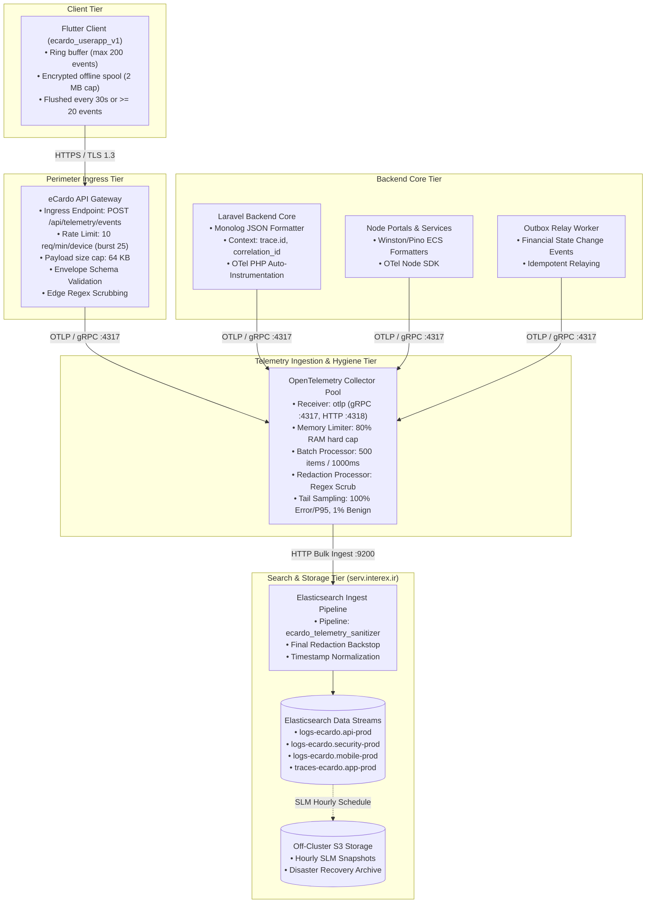

# eCardo Telemetry & Elasticsearch Implementation Specification

- **Document Version:** 1.0.0
- **Status:** APPROVED / IMPLEMENTATION SPECIFICATION
- **Date:** 2026-10-18
- **Applicable Cluster:** `serv.interex.ir` (Production: 192.168.100.65 / Staging: 192.168.100.66)
- **Engine Version:** Elasticsearch 8.x + Kibana 8.x
- **Target Repository:** `ecardo_userapp_v1`
- **Applicable Components:** OpenTelemetry Collector Pool, API Gateway Ingress, Laravel Core Backend, Mobile Telemetry Client

---

## 1. Executive Charter & Architectural Boundary

This document defines the complete technical implementation specification for operational search, structured log aggregation, distributed APM tracing, and health telemetry within the eCardo platform.

```
+---------------------------------------------------------------------------------------------------+
|                                  CRITICAL FINTECH SYSTEM BOUNDARY                                 |
+---------------------------------------------------------------------------------------------------+
| 1. Elasticsearch is EXCLUSIVELY an operational search, diagnostic, and telemetry index.           |
| 2. Elasticsearch is NEVER the system of record or source of truth for:                            |
|    - Account balances, wallet funds, or double-entry ledger postings.                             |
|    - Payment authorization states, callback reconciliations, or settlement finality.             |
|    - User KYC approval status, tier permissions, or security passcodes.                           |
| 3. Total failure or partition of the Elasticsearch cluster MUST NOT abort, delay, or block any    |
|    financial transaction or backend ledger commit.                                                |
| 4. Client applications (Flutter iOS/Android/Web) NEVER connect directly to Elasticsearch.         |
| 5. All queries on search indexes operate on downstream, eventually consistent read projections.    |
+---------------------------------------------------------------------------------------------------+
```

---

## 2. Telemetry Pipeline Architecture

The end-to-end telemetry lifecycle flows from distributed edge applications through an isolated Collector tier into versioned Elasticsearch Data Streams:



---

## 3. Data Streams & Composable Index Templates

All telemetry records are stored in Elasticsearch **Data Streams** conforming to the Elastic Common Schema (ECS v8.x). Data streams provide append-only performance, automated rolling indices, and transparent query interfaces across hot, warm, and cold backing shards.

### 3.1 Data Stream Naming Taxonomy

| Data Stream Name | Purpose & Telemetry Class | Shard Allocation | Default Refresh | Write Routing |
| :--- | :--- | :--- | :--- | :--- |
| **`logs-ecardo.api-prod`** | Backend operational JSON logs, API requests, SQL slow queries, worker executions. | 1 Primary, 1 Replica | 5s | Direct OTel Bulk Export |
| **`logs-ecardo.security-prod`** | Authentication attempts, passcode lockouts, token revocations, admin audits. | 1 Primary, 1 Replica | 2s | Direct OTel Bulk Export |
| **`logs-ecardo.mobile-prod`** | Sanitized client-side diagnostics, UI network latency, offline recovery events. | 1 Primary, 1 Replica | 10s | Gateway `/api/telemetry/events` |
| **`traces-ecardo.app-prod`** | Distributed APM spans, trace trees, cross-service RPC timings. | 1 Primary, 1 Replica | 5s | Direct OTel Collector Trace Sink |
| **`metrics-ecardo.system-prod`**| SRE metrics, CPU/memory saturation, connection pool counters. | 1 Primary, 1 Replica | 10s | Prometheus / OTel Exporter |

---

## 4. Strict Index Mappings (Prevention of Mapping Explosion)

To eliminate the catastrophic hazard of cluster unresponsiveness caused by uncontrolled Lucene mapping explosions, all eCardo telemetry indices enforce **`dynamic: strict`** on top-level and attribute envelopes. Unregistered fields are immediately rejected at the ingestion boundary.

### 4.1 Composable Component Template: Base ECS Schema

```bash
curl -X PUT "https://serv.interex.ir:9200/_component_template/ecardo_ecs_base_mapping" \
  -u "${ES_ADMIN_USER}:${ES_ADMIN_PASSWORD}" \
  -H "Content-Type: application/json" \
  --cacert /etc/elasticsearch/certs/ca.crt \
  -d '{
  "template": {
    "mappings": {
      "dynamic": "strict",
      "properties": {
        "@timestamp": { "type": "date" },
        "service": {
          "properties": {
            "name": { "type": "keyword" },
            "version": { "type": "keyword" },
            "environment": { "type": "keyword" },
            "node": {
              "properties": {
                "name": { "type": "keyword" }
              }
            }
          }
        },
        "event": {
          "properties": {
            "id": { "type": "keyword" },
            "schema_version": { "type": "keyword" },
            "category": { "type": "keyword" },
            "action": { "type": "keyword" },
            "outcome": { "type": "keyword" },
            "duration": { "type": "long" }
          }
        },
        "trace": {
          "properties": {
            "id": { "type": "keyword" }
          }
        },
        "span": {
          "properties": {
            "id": { "type": "keyword" }
          }
        },
        "correlation_id": { "type": "keyword" },
        "source": { "type": "keyword" },
        "pseudonymous_user_id": { "type": "keyword" },
        "http": {
          "properties": {
            "request": {
              "properties": {
                "method": { "type": "keyword" },
                "route": { "type": "keyword" }
              }
            },
            "response": {
              "properties": {
                "status_code": { "type": "short" }
              }
            }
          }
        },
        "error": {
          "properties": {
            "code": { "type": "keyword" },
            "type": { "type": "keyword" },
            "message": { "type": "text", "analyzer": "standard" },
            "stack_trace": { "type": "text", "index": false }
          }
        },
        "log": {
          "properties": {
            "level": { "type": "keyword" },
            "logger": { "type": "keyword" }
          }
        },
        "message": { "type": "text", "analyzer": "standard" },
        "attributes": {
          "dynamic": "strict",
          "properties": {
            "domain": { "type": "keyword" },
            "operation_id": { "type": "keyword" },
            "provider_alias": { "type": "keyword" },
            "provider_result_code": { "type": "keyword" },
            "latency_ms": { "type": "integer" },
            "card_suffix_last4": { "type": "keyword" },
            "currency_bucket": { "type": "keyword" },
            "failure_reason_code": { "type": "keyword" },
            "challenge_type": { "type": "keyword" },
            "app_locale": { "type": "keyword" },
            "network_transport": { "type": "keyword" }
          }
        }
      }
    }
  }
}'
```

### 4.2 Index Templates Attaching Canonical Mappings & Settings

```bash
# Composable template for API operational logs
curl -X PUT "https://serv.interex.ir:9200/_index_template/ecardo_api_logs_template" \
  -u "${ES_ADMIN_USER}:${ES_ADMIN_PASSWORD}" \
  -H "Content-Type: application/json" \
  --cacert /etc/elasticsearch/certs/ca.crt \
  -d '{
  "index_patterns": ["logs-ecardo.api-*"],
  "data_stream": {},
  "priority": 500,
  "composed_of": ["ecardo_ecs_base_mapping"],
  "template": {
    "settings": {
      "index.lifecycle.name": "ecardo_api_ilm_policy",
      "index.number_of_shards": 1,
      "index.number_of_replicas": 1,
      "index.refresh_interval": "5s",
      "index.codec": "best_compression",
      "index.mapping.total_fields.limit": 1000,
      "default_pipeline": "ecardo_telemetry_sanitizer"
    }
  }
}'

# Composable template for Security & Audit logs
curl -X PUT "https://serv.interex.ir:9200/_index_template/ecardo_security_logs_template" \
  -u "${ES_ADMIN_USER}:${ES_ADMIN_PASSWORD}" \
  -H "Content-Type: application/json" \
  --cacert /etc/elasticsearch/certs/ca.crt \
  -d '{
  "index_patterns": ["logs-ecardo.security-*"],
  "data_stream": {},
  "priority": 500,
  "composed_of": ["ecardo_ecs_base_mapping"],
  "template": {
    "settings": {
      "index.lifecycle.name": "ecardo_security_ilm_policy",
      "index.number_of_shards": 1,
      "index.number_of_replicas": 1,
      "index.refresh_interval": "2s",
      "index.codec": "best_compression",
      "index.mapping.total_fields.limit": 1000,
      "default_pipeline": "ecardo_telemetry_sanitizer"
    }
  }
}'

# Composable template for Client Telemetry
curl -X PUT "https://serv.interex.ir:9200/_index_template/ecardo_mobile_logs_template" \
  -u "${ES_ADMIN_USER}:${ES_ADMIN_PASSWORD}" \
  -H "Content-Type: application/json" \
  --cacert /etc/elasticsearch/certs/ca.crt \
  -d '{
  "index_patterns": ["logs-ecardo.mobile-*"],
  "data_stream": {},
  "priority": 500,
  "composed_of": ["ecardo_ecs_base_mapping"],
  "template": {
    "settings": {
      "index.lifecycle.name": "ecardo_mobile_ilm_policy",
      "index.number_of_shards": 1,
      "index.number_of_replicas": 1,
      "index.refresh_interval": "10s",
      "index.codec": "best_compression",
      "index.mapping.total_fields.limit": 500,
      "default_pipeline": "ecardo_telemetry_sanitizer"
    }
  }
}'

# Composable template for Distributed APM Traces
curl -X PUT "https://serv.interex.ir:9200/_index_template/ecardo_traces_template" \
  -u "${ES_ADMIN_USER}:${ES_ADMIN_PASSWORD}" \
  -H "Content-Type: application/json" \
  --cacert /etc/elasticsearch/certs/ca.crt \
  -d '{
  "index_patterns": ["traces-ecardo.*"],
  "data_stream": {},
  "priority": 500,
  "composed_of": ["ecardo_ecs_base_mapping"],
  "template": {
    "settings": {
      "index.lifecycle.name": "ecardo_traces_ilm_policy",
      "index.number_of_shards": 1,
      "index.number_of_replicas": 1,
      "index.refresh_interval": "5s",
      "index.codec": "best_compression",
      "index.mapping.total_fields.limit": 500
    }
  }
}'
```

---

## 5. Index Lifecycle Management (ILM) Policies

In self-managed Elasticsearch environments, data stream indices do not automatically clean up or roll over unless explicitly driven by Index Lifecycle Management (ILM) policies. eCardo defines four distinct lifecycle phases:

```
+---------------+       +---------------+       +---------------+       +---------------+
|   HOT PHASE   | ----> |  WARM PHASE   | ----> |  COLD PHASE   | ----> | DELETE PHASE  |
+---------------+       +---------------+       +---------------+       +---------------+
| Write & Query |       | Read-Only     |       | Searchable    |       | Irreversible  |
| Shard: NVMe   |       | ForceMerge: 1 |       | Snapshots     |       | Purge from    |
| Priority: 100 |       | Priority: 50  |       | Priority: 20  |       | Disk Store    |
+---------------+       +---------------+       +---------------+       +---------------+
```

### 5.1 Executable Policy Definitions

#### 1. API Logs Policy (`ecardo_api_ilm_policy`) — 90 Days Retention
- **Hot:** Rollover at `50gb` primary shard size or `7d` age. Priority 100.
- **Warm:** Starts at `7d`. Read-only, `forcemerge` to 1 segment, 1 replica. Priority 50.
- **Cold:** Starts at `30d`. Mount as searchable snapshots, 0 replicas. Priority 20.
- **Delete:** Hard purge at `90d`.

```bash
curl -X PUT "https://serv.interex.ir:9200/_ilm/policy/ecardo_api_ilm_policy" \
  -u "${ES_ADMIN_USER}:${ES_ADMIN_PASSWORD}" \
  -H "Content-Type: application/json" \
  --cacert /etc/elasticsearch/certs/ca.crt \
  -d '{
  "policy": {
    "phases": {
      "hot": {
        "min_age": "0ms",
        "actions": {
          "set_priority": { "priority": 100 },
          "rollover": {
            "max_primary_shard_size": "50gb",
            "max_age": "7d"
          }
        }
      },
      "warm": {
        "min_age": "7d",
        "actions": {
          "set_priority": { "priority": 50 },
          "readonly": {},
          "forcemerge": { "max_num_segments": 1 },
          "allocate": { "number_of_replicas": 1 }
        }
      },
      "cold": {
        "min_age": "30d",
        "actions": {
          "set_priority": { "priority": 20 },
          "allocate": { "number_of_replicas": 0 }
        }
      },
      "delete": {
        "min_age": "90d",
        "actions": {
          "delete": { "delete_searchable_snapshot": true }
        }
      }
    }
  }
}'
```

#### 2. Security & Audit Logs Policy (`ecardo_security_ilm_policy`) — 180 Days Retention
- **Hot:** Rollover at `50gb` primary shard size or `14d` age. Priority 100.
- **Warm:** Starts at `14d`. Read-only, `forcemerge` to 1 segment, 1 replica. Priority 50.
- **Cold:** Starts at `60d`. Searchable snapshots, 0 replicas. Priority 20.
- **Delete:** Hard purge at `180d`.

```bash
curl -X PUT "https://serv.interex.ir:9200/_ilm/policy/ecardo_security_ilm_policy" \
  -u "${ES_ADMIN_USER}:${ES_ADMIN_PASSWORD}" \
  -H "Content-Type: application/json" \
  --cacert /etc/elasticsearch/certs/ca.crt \
  -d '{
  "policy": {
    "phases": {
      "hot": {
        "min_age": "0ms",
        "actions": {
          "set_priority": { "priority": 100 },
          "rollover": {
            "max_primary_shard_size": "50gb",
            "max_age": "14d"
          }
        }
      },
      "warm": {
        "min_age": "14d",
        "actions": {
          "set_priority": { "priority": 50 },
          "readonly": {},
          "forcemerge": { "max_num_segments": 1 },
          "allocate": { "number_of_replicas": 1 }
        }
      },
      "cold": {
        "min_age": "60d",
        "actions": {
          "set_priority": { "priority": 20 },
          "allocate": { "number_of_replicas": 0 }
        }
      },
      "delete": {
        "min_age": "180d",
        "actions": {
          "delete": { "delete_searchable_snapshot": true }
        }
      }
    }
  }
}'
```

#### 3. Client Telemetry Policy (`ecardo_mobile_ilm_policy`) — 30 Days Retention
- **Hot:** Rollover at `25gb` primary shard size or `7d` age. Priority 100.
- **Warm:** Starts at `7d`. Read-only, `forcemerge` to 1 segment, 1 replica. Priority 50.
- **Cold:** Skipped.
- **Delete:** Hard purge at `30d`.

```bash
curl -X PUT "https://serv.interex.ir:9200/_ilm/policy/ecardo_mobile_ilm_policy" \
  -u "${ES_ADMIN_USER}:${ES_ADMIN_PASSWORD}" \
  -H "Content-Type: application/json" \
  --cacert /etc/elasticsearch/certs/ca.crt \
  -d '{
  "policy": {
    "phases": {
      "hot": {
        "min_age": "0ms",
        "actions": {
          "set_priority": { "priority": 100 },
          "rollover": {
            "max_primary_shard_size": "25gb",
            "max_age": "7d"
          }
        }
      },
      "warm": {
        "min_age": "7d",
        "actions": {
          "set_priority": { "priority": 50 },
          "readonly": {},
          "forcemerge": { "max_num_segments": 1 },
          "allocate": { "number_of_replicas": 1 }
        }
      },
      "delete": {
        "min_age": "30d",
        "actions": {
          "delete": {}
        }
      }
    }
  }
}'
```

#### 4. Raw APM Traces Policy (`ecardo_traces_ilm_policy`) — 14 Days Retention
- **Hot:** Rollover at `25gb` primary shard size or `3d` age. Priority 100.
- **Warm:** Starts at `3d`. Read-only, `forcemerge` to 1 segment, 1 replica. Priority 50.
- **Cold:** Skipped.
- **Delete:** Hard purge at `14d`.

```bash
curl -X PUT "https://serv.interex.ir:9200/_ilm/policy/ecardo_traces_ilm_policy" \
  -u "${ES_ADMIN_USER}:${ES_ADMIN_PASSWORD}" \
  -H "Content-Type: application/json" \
  --cacert /etc/elasticsearch/certs/ca.crt \
  -d '{
  "policy": {
    "phases": {
      "hot": {
        "min_age": "0ms",
        "actions": {
          "set_priority": { "priority": 100 },
          "rollover": {
            "max_primary_shard_size": "25gb",
            "max_age": "3d"
          }
        }
      },
      "warm": {
        "min_age": "3d",
        "actions": {
          "set_priority": { "priority": 50 },
          "readonly": {},
          "forcemerge": { "max_num_segments": 1 },
          "allocate": { "number_of_replicas": 1 }
        }
      },
      "delete": {
        "min_age": "14d",
        "actions": {
          "delete": {}
        }
      }
    }
  }
}'
```

---

## 6. Strict Telemetry Redaction & Defense-in-Depth

eCardo enforces a zero-trust sanitization model with five independent barriers. A failure at any single layer is caught by subsequent downstream filters before data hits disk.

```
[ Tier 1: Client Filter (Flutter) ]
        |
        v
[ Tier 2: Ingress API Gateway Filter (WAF / Nginx) ]
        |
        v
[ Tier 3: Backend Application Log Masker (Laravel Monolog) ]
        |
        v
[ Tier 4: OpenTelemetry Collector Redaction Processor ]
        |
        v
[ Tier 5: Elasticsearch Ingest Pipeline Sanitizer ]
        |
        v
[ Final Encrypted Data Stream Index ]
```

### 6.1 Strictly Prohibited Data (The Negative Allowlist)

The following items are **categorically forbidden** from appearing in any log line, metric label, trace attribute, or diagnostic payload:

1. **Cardholder Data:** Full Primary Account Numbers (16-digit PAN), Card Verification Values (CVV / CVV2 / CVC), Card Expiration Dates, Track 1/Track 2 data.
2. **Authentication Secrets:** Passwords, passcodes, biometric templates, hardware keystore private keys, security question answers.
3. **Session Credentials:** JWT Bearer tokens, refresh tokens, session cookies, API secret keys.
4. **One-Time Passcodes:** SMS OTPs, email verification codes, TOTP authenticator secret keys.
5. **National Identity Identifiers:** Raw Iranian National ID (Melli Code), international passports, social security numbers, identity document scans/photos.
6. **Raw Banking Payloads:** Complete Shaparak gateway callback dumps, raw ISO 8583 message packets, full bank account numbers (IBAN/Sheba).

### 6.2 Canonical Ingest Pipeline Sanitizer (`ecardo_telemetry_sanitizer`)

This ingest pipeline is attached to all telemetry index templates as the final server-side backstop:

```bash
curl -X PUT "https://serv.interex.ir:9200/_ingest/pipeline/ecardo_telemetry_sanitizer" \
  -u "${ES_ADMIN_USER}:${ES_ADMIN_PASSWORD}" \
  -H "Content-Type: application/json" \
  --cacert /etc/elasticsearch/certs/ca.crt \
  -d '{
  "description": "eCardo Ingest Telemetry Sanitizer - Final Defense Redaction Engine",
  "processors": [
    {
      "redact": {
        "field": "message",
        "patterns": [
          "(?i)\\b(?:4[0-9]{12}(?:[0-9]{3})?|5[1-5][0-9]{14}|6(?:011|5[0-9][0-9])[0-9]{12}|3[47][0-9]{13})\\b",
          "(?i)\\b(?:5022|5041|5892|6037|6104|6219|6273|6274|6276|6277|6279|6280|6362|6367|6369|6393|6395|6396|9919)[0-9]{12}\\b"
        ],
        "prefix": "[REDACTED_PAN_",
        "suffix": "]",
        "ignore_missing": true
      }
    },
    {
      "gsub": {
        "field": "message",
        "pattern": "(?i)\\b(cvv|cvv2|cvc|cid)\\b[\\s:=\"'\''\\\\/]+(\\d{3,4})\\b",
        "replacement": "$1=[REDACTED_CVV]",
        "ignore_missing": true
      }
    },
    {
      "gsub": {
        "field": "message",
        "pattern": "(?i)\\b(password|passcode|pin|secret|private_key)\\b[\\s:=\"'\''\\\\/]+[^\\s,\"'\''}]+",
        "replacement": "$1=[REDACTED_SECRET]",
        "ignore_missing": true
      }
    },
    {
      "gsub": {
        "field": "message",
        "pattern": "(?i)bearer\\s+[A-Za-z0-9\\-_=]+\\.[A-Za-z0-9\\-_=]+\\.[A-Za-z0-9\\-_=]+",
        "replacement": "Bearer [REDACTED_JWT_TOKEN]",
        "ignore_missing": true
      }
    },
    {
      "gsub": {
        "field": "message",
        "pattern": "(?i)\\bIR[0-9]{24}\\b",
        "replacement": "[REDACTED_SHEBA_IBAN]",
        "ignore_missing": true
      }
    },
    {
      "gsub": {
        "field": "message",
        "pattern": "(?i)\\b(national_id|melli_code|ssn)\\b[\\s:=\"'\''\\\\/]+(\\d{10})\\b",
        "replacement": "$1=[REDACTED_NATIONAL_ID]",
        "ignore_missing": true
      }
    }
  ]
}'
```

### 6.3 Automated CI Redaction Verification Test

All platform pull requests must execute the negative security test suite (`scripts/check_no_sensitive_telemetry.py`), verifying that synthetic fixtures containing mock PANs, CVVs, tokens, and passcodes are 100% sanitized across all logging adapters before merge approval.

---

## 7. Off-Cluster Snapshot & Disaster Recovery Drill Specification

Elasticsearch telemetry snapshots provide insurance against catastrophic host failure, volume corruption, or accidental index deletion.

### 7.1 Off-Cluster S3 Repository Configuration

Snapshots are stored in an encrypted, off-cluster S3-compatible object store (`s3.storage.interex.ir`) physically isolated from the Elasticsearch server:

```bash
# Register S3 Snapshot Repository
curl -X PUT "https://serv.interex.ir:9200/_snapshot/ecardo_s3_telemetry_backup" \
  -u "${ES_ADMIN_USER}:${ES_ADMIN_PASSWORD}" \
  -H "Content-Type: application/json" \
  --cacert /etc/elasticsearch/certs/ca.crt \
  -d '{
  "type": "s3",
  "settings": {
    "bucket": "ecardo-telemetry-snapshots-prod",
    "base_path": "cluster-backups",
    "client": "default",
    "compress": true,
    "server_side_encryption": true,
    "max_restore_bytes_per_sec": "100mb",
    "max_snapshot_bytes_per_sec": "50mb"
  }
}'
```

### 7.2 Snapshot Lifecycle Management (SLM) Policy

Snapshots execute hourly to guarantee an operational Recovery Point Objective (RPO) under 1 hour:

```bash
curl -X PUT "https://serv.interex.ir:9200/_slm/policy/ecardo_hourly_telemetry_snapshots" \
  -u "${ES_ADMIN_USER}:${ES_ADMIN_PASSWORD}" \
  -H "Content-Type: application/json" \
  --cacert /etc/elasticsearch/certs/ca.crt \
  -d '{
  "schedule": "0 0 * * * ?",
  "name": "<ecardo-telemetry-snap-{now/d{yyyy.MM.dd}}-{now/m{mm}}>",
  "repository": "ecardo_s3_telemetry_backup",
  "config": {
    "indices": ["logs-ecardo.*", "traces-ecardo.*"],
    "ignore_unavailable": true,
    "include_global_state": false
  },
  "retention": {
    "expire_after": "30d",
    "min_count": 48,
    "max_count": 720
  }
}'
```

### 7.3 Mandatory Quarterly Restore Drill Protocol

To ensure disaster recovery readiness, SRE and Platform teams must execute a formal **Snapshot Restore Drill** every 90 days.

```
DRILL TARGETS:
• Recovery Point Objective (RPO): < 1 Hour
• Recovery Time Objective (RTO):  < 2 Hours
• Execution Environment:          Isolated Staging / Drill Cluster
```

#### Step-by-Step Drill Execution Procedure:

1. **Verify Target Isolation:**
   - Confirm target cluster is the isolated staging node (`192.168.100.66`). Never run recovery testing on active production indices.
2. **Discover Latest Snapshot:**
   ```bash
   LATEST_SNAP=$(curl -s -u "${ES_ADMIN_USER}:${ES_ADMIN_PASSWORD}" \
     "https://serv.interex.ir:9200/_cat/snapshots/ecardo_s3_telemetry_backup?s=end_epoch:desc&format=json" \
     | jq -r '.[0].id')
   echo "Target Recovery Snapshot: ${LATEST_SNAP}"
   ```
3. **Execute Restore with Index Renaming:**
   Restore into a sandboxed verification namespace to avoid overwriting current telemetry:
   ```bash
   curl -X POST "https://staging.interex.ir:9200/_snapshot/ecardo_s3_telemetry_backup/${LATEST_SNAP}/_restore?wait_for_completion=true" \
     -u "${STAGING_ADMIN_USER}:${STAGING_ADMIN_PASSWORD}" \
     -H "Content-Type: application/json" \
     -d '{
       "indices": "logs-ecardo.api-prod",
       "ignore_unavailable": true,
       "include_global_state": false,
       "rename_pattern": "(.+)",
       "rename_replacement": "restored_drill_$1"
     }'
   ```
4. **Validate Restored Shard Health & Data Integrity:**
   ```bash
   # Check shard allocation
   curl -s -u "${STAGING_ADMIN_USER}:${STAGING_ADMIN_PASSWORD}" \
     "https://staging.interex.ir:9200/_cat/indices/restored_drill_*?v"

   # Verify document count and query responsiveness
   DOC_COUNT=$(curl -s -u "${STAGING_ADMIN_USER}:${STAGING_ADMIN_PASSWORD}" \
     "https://staging.interex.ir:9200/restored_drill_*/_count" | jq -r '.count')
   echo "Restored Documents Verified: ${DOC_COUNT}"
   ```
5. **Measure RTO / RPO Achievement:**
   - Record exact restoration elapsed duration. Must be under 120 minutes.
   - Calculate data loss gap between snapshot end time and current timestamp.
6. **Teardown & Drill Sign-Off:**
   - Clean up restored drill indices (`DELETE /restored_drill_*`).
   - Sign and archive recovery attestation report in `docs/operations/SNAPSHOT-RESTORE-DRILL.md`.

---

## 8. SRE Health Alerts & Cluster Telemetry Runbook

The platform monitoring stack continuously evaluates cluster health against critical thresholds:

| Metric / Alert Rule | Severity | Evaluation Threshold | Automated Action / Runbook |
| :--- | :--- | :--- | :--- |
| **Cluster Red Status** | **P0 - Critical** | Any primary shard unassigned for > 60 seconds. | Alert SRE On-Call immediately. Check node availability and disk mounts. |
| **Cluster Yellow Status** | **P2 - Warning** | Replica shards unassigned for > 15 minutes. | Check disk balance across data nodes and reallocation locks. |
| **Disk High Watermark** | **P1 - High** | Any data node disk usage > 85%. | Alert SRE. ILM forces early rollover; migrate older cold indices to S3. |
| **Disk Flood Watermark** | **P0 - Critical** | Any data node disk usage > 95%. | Shards become read-only (`index.blocks.read_only_allow_delete: true`). Emergency purge of expired indices. |
| **Ingestion Lag Spike** | **P1 - High** | OTel collector buffer queue > 75% full for > 5 min. | Scale OTel collector pods; investigate ES indexing backpressure. |
| **Search Thread Pool Rejection** | **P2 - Warning** | Search thread queue rejections > 50/min. | Optimize high-cost queries, check unindexed filter clauses. |
